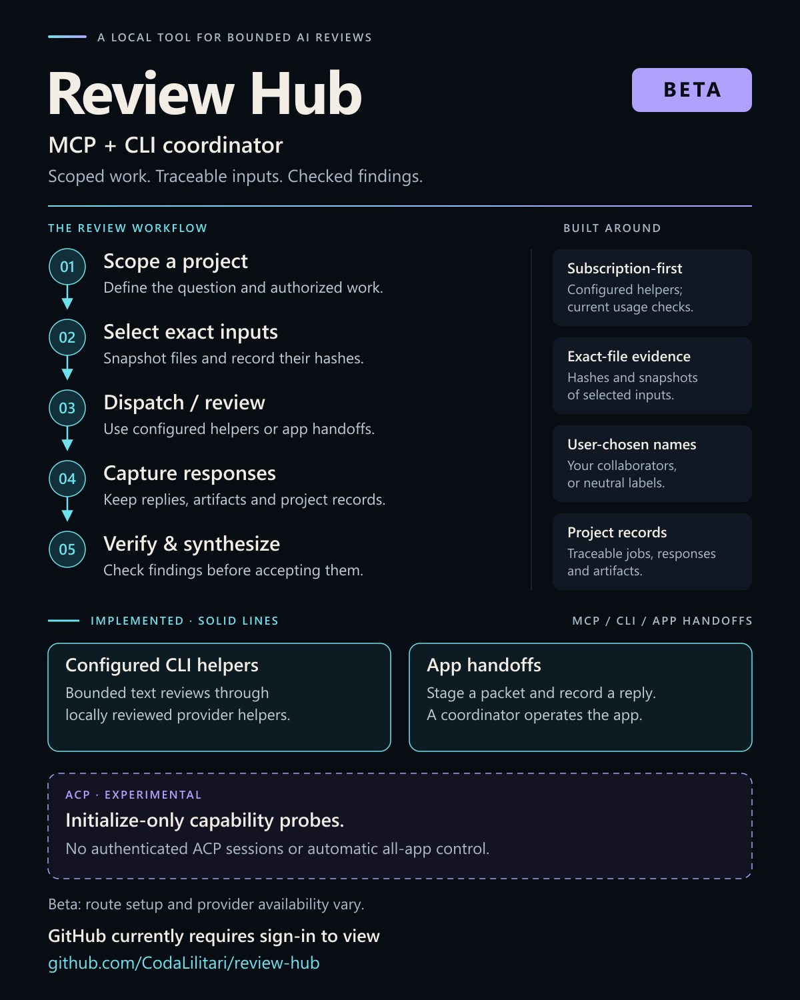

# Review Hub (beta)

A local MCP server and CLI for coordinating bounded AI reviews, tracking exact inputs, and collecting responses. The Python package remains `coda_review_hub`; that is project branding, not an identity assigned to the user or their assistants.

The coordinator chooses relevant reviewers and verifies consequential findings. The hub supplies job records, parallel dispatch, duplicate prevention, attachment snapshots, cancellation, and app handoffs. It does not turn a review into authority to execute changes.

[](docs/assets/review-hub-beta.svg)

[Public case study and text explanation](https://richard-pemberton-research.darkahn.chatgpt.site/projects/review-hub/index.html) · [Editable SVG](docs/assets/review-hub-beta.svg)

## Review results and comparison reports

Version 0.6 adds append-only structured findings, exact snapshot citation checks, explicit session relationships, attachment capability records, and static HTML/Markdown comparisons. Reports use selected saved jobs and make no provider requests. Matching a quoted line verifies the citation, not the finding. The five new MCP tools have CLI equivalents; see [v0.6 usage and limits](docs/review-results-v0.6.md).

A separate [mock ACP contract experiment](experimental/acpx/README.md) exercises session identity, permission denial, failure and retry behavior using a bundled synthetic agent. It is not a live acpx/provider integration, does not authenticate an account, and adds no production provider route. Installed provider applications remain outside version control.

## Maturity and scope

**v0.6 is beta software:** an early, Windows-first implementation with synthetic test fixtures. It is not a turnkey installer for provider products, a billing service, or a universally authenticated multi-agent framework. Other platforms need separate validation.

**Repository access (2026-09-20):** GitHub currently requires sign-in to view this repository. Its public visibility setting does not establish anonymous access.

Three automated provider slots, `claude-code`, `grok` and `antigravity`, can use **locally supplied, reviewed subscription helpers**. The former `gemini-cli` route is retired; historical records remain readable. No CLI route is ready merely because this package is installed. App handoffs work independently of those helpers: they prepare packets and record coordinator-observed replies without controlling a browser or desktop app.

The production transport is local stdio MCP plus CLI wrappers. Authenticated ACP session management, provider-session resume, autonomous project editing, automatic image generation, and a persistent background service remain outside production scope. The separate mock ACP experiment establishes a local contract only. Provider capability is distinct from hub integration.

## Installation

Use Python 3.11 or later. From a checked-out copy on Windows:

```powershell
py -3 -m venv .venv
.\.venv\Scripts\python.exe -m pip install -r requirements.lock
.\.venv\Scripts\python.exe -m pip install -e .
.\.venv\Scripts\python.exe -m coda_review_hub.cli --help
```

The command entry points are `coda-review` and `coda-review-mcp`. Register the latter, or the environment's Python executable with `-m coda_review_hub.mcp_server`, with an MCP client that supports local stdio servers. Choose one private state directory outside the repository and use it consistently across clients. No HTTP listener is started.

The repository ships `helpers.example.json` and generic helpers for Claude Code, Grok Build, and Antigravity; it contains no personal helper configuration or account data. Automated dispatch requires reviewed local helpers configured in ignored `helpers.local.json`, including verified helper-source hashes; model/effort choices are saved separately after discovery. The example's zero hashes are placeholders, not usable pins. Read the [adapter contract](docs/adapter-contract.md) and [Antigravity setup and boundaries](docs/antigravity-v0.4.md) before enabling a helper.

## Model setup and compatible updates (v0.5)

On first use, discover the models and thinking levels exposed through the current account and installed client, ask the user, and save that choice outside Git. Every new automated request refreshes the catalog. New/removed models, changed effort options, and changed resolved aliases prompt again; compatible app updates and cosmetic labels do not. Claude Code discovery includes a nonfatal official-release advisory because older clients can omit newer account models. CLI `choose-model` asks interactively. Consumer apps require actual picker observations. See [model setup](docs/models-and-updates-v0.5.md).

Claude Code has the explicit `claude-code` route; `claude` remains a legacy CLI alias. `claude-desktop` and `claude-cowork` are separate app handoffs. No app entitlement is inferred from another surface.

Official app versions are observations rather than frozen compatibility requirements. Current Windows publisher signatures, required capabilities and billing controls are checked each run; our own helper source remains hash-verified. Apps, installers, profiles and credentials stay outside version control.

## Antigravity replacement

Antigravity has its own `antigravity` provider ID. The upgrade does not redirect old Gemini requests, reuse their entitlement observations, or reinterpret their saved replies. Review the new helper and runtime, verify the current account's included usage and disabled paid fallback, then create a separate helper pin and usage observation. The deprecated Gemini helper implementation has been removed; only retirement errors and historical record compatibility remain.

A development diagnostic using the official Antigravity CLI 1.2.7 returned a nonsensitive synthetic response with `gemini-3.8-flash-high` selected and no observed tool calls. A bounded review through the guarded helper returned on September 25 with `gemini-3.1-pro-high` selected. These dated results do not establish continued entitlement, tool isolation, or a verified backend model identity. The current user selects from their own account catalog; examples do not establish availability or entitlement.

The integration wraps the CLI through the hub's existing local MCP interface. It implements no Antigravity ACP sessions. Earlier ACP initialization experiments remain historical protocol probes. See [Antigravity migration, subscription checks, and validation boundaries](docs/antigravity-v0.4.md).

## Your ChatGPT reviewer

The `chatgpt` route is included. Check the user's established ChatGPT collaborator and project conversation, inspect their signed-in account's current model and thinking/mode options, and save their explicit preference. A fresh picker observation is required for every handoff; changes to the options require confirmation. Names and model preferences are user-configured, with no personal defaults in this public package. See the [ChatGPT handoff procedure](docs/chatgpt-handoff.md), including how to record a user-authorized conditional fallback.

This route prepares a packet and records a coordinator-observed reply. It does not send automatically, infer account access from an OpenAI API catalog, or substitute the coordinator's Codex model for the user's ChatGPT conversation.

## Gemini and Meta app handoffs

Distinct app handoffs are available for `gemini-desktop`, `gemini-spark`, `meta-ai` and `meta-muse`, alongside the existing Gemini browser route. Exact attachment snapshots and returned artifacts use the same checks. App receipts can preserve observed model/mode labels without claiming a verified backend identity.

These app handoffs are distinct from the Antigravity automated route. They preserve project scope and observed app receipts; they do not prove desktop control, authenticated ACP sessions, or automatic uploads. The [Gemini/Meta v0.3 notes](docs/gemini-meta-v0.3.md) remain historical context, including the retired Gemini CLI experiment. Use the v0.4 Antigravity documentation for current automated setup.

## Identities belong to the user

Start with `identity_status`. If local choices already exist, inspect and reuse them. Otherwise, ask whether the user has established names for their coordinator and collaborators; do not infer names from product labels or unrelated conversation history. Use `configure_identity` to save the confirmed choices outside the repository.

An explicit anonymous choice is supported. It allows neutral introductions without inventing identities. The first-run requirement is a deliberate choice, not compulsory naming. Display names never establish account access, model identity, billing entitlement, or authority to send material.

## Twenty MCP tools

| Tool | Purpose |
|---|---|
| `identity_status` | Inspect local identity setup and whether a choice is needed. |
| `configure_identity` | Persist confirmed names or an explicit anonymous choice locally. |
| `routes` | Inspect route configuration and readiness limits without contacting a provider. |
| `model_status` | Inspect saved catalog and user choice. |
| `refresh_models` | Query current CLI account options without a model prompt. |
| `record_models` | Record a signed-in app's visible options. |
| `select_model` | Save the user's confirmed model and thinking level. |
| `observe_usage` | Record a sourced, recent included-usage observation. |
| `submit` | Prepare a bounded automated batch and return job IDs. |
| `jobs` | Read project-scoped status and reconcile interrupted work. |
| `result` | Read a bounded page of a response and its completion state. |
| `attachment_files` | Recheck saved input/output files and return their exact paths. |
| `cancel` | Request local process-tree termination. |
| `handoff` | Prepare a scoped app packet and optional file snapshots. |
| `record_handoff_result` | Record a reply, attachment observation, and optional returned files. |
| `capabilities` | Describe implemented file/session contracts without querying accounts. |
| `record_review` | Append advisory findings and check exact saved source citations. |
| `review` | Read findings, revisions and refreshed integrity checks. |
| `record_lineage` | Record observed parent context without sending or resuming. |
| `comparison_report` | Render selected local records as inert HTML or Markdown. |

Inspect the current tool schemas or CLI help for argument details. A batch accepts at most one request per automated provider, allowing up to three providers to run concurrently. Active jobs for the same provider are serialized across projects sharing the state directory.

## Subscription checks and delivery

Every automated send needs a real observation of available included usage and disabled paid extra usage. Set `paid_usage_disabled=true` only when that condition has actually been verified. The observation expires after one hour and permits only a bounded number of dispatches. It is coordinator testimony, not an independent billing query or a guarantee against later account changes. Authentication alone is insufficient. Missing entitlement, expired authentication, uncertain billing, or exhausted allowance must stop dispatch; never substitute API billing silently.

Use a stable idempotency key for each logical batch. Reusing it with identical inputs returns the original jobs. Inspect those jobs before retrying an uncertain send. A new key creates a new attempt, not continuation.

`returned` means the helper reported successful completion and provided a nonempty final answer; findings still need verification. `blocked`, `failed`, and `delivery_unknown` preserve different failure conditions. Cancellation cannot prove that a provider received nothing. Keep the MCP host connected while work runs: saved records survive interruption, but execution is not promised to survive host exit.

## Files and privacy

Automated routes embed selected UTF-8 source/text snapshots in the packet. App handoffs can stage native files, including images, for a separately operated upload. Staging is not sending. See [attachment routes](docs/attachment-routes.md) for limits, provider distinctions, and returned artifacts.

Keep local identities, helper configuration, job databases, requests, responses, snapshots, account observations and session references out of version control. Raw provider receipts can contain private diagnostics or reasoning. Normal result tools expose the final answer and selected metadata, not the raw stream.

Project binding prevents accidental cross-project retrieval. It is not isolation from other programs running as the same operating-system user. Windows Job Objects constrain process lifetime, not filesystem or network access. The coordinator remains responsible for disclosure scope and independent validation.

## Development

```powershell
.\.venv\Scripts\python.exe -B -m unittest discover -s tests -v
.\.venv\Scripts\python.exe -m pip check
```

Tests use synthetic inputs and local fake helpers; they do not establish live provider authentication or entitlement. Run relevant checks after changing a helper, transport, identity setup, or attachment handling.

License information is pending the repository owner's choice.

Current checkpoint: the [v0.5 validation record](docs/validation-v0.5-2026-09-25.md). The [v0.4 validation record](docs/validation-v0.4-2026-09-22.md) is historical. The [v0.3 beta validation record](docs/validation-v0.3-2026-09-20.md) covers the earlier release and does not establish v0.4 validation. Setup steps and remaining checks are in the [Antigravity notes](docs/antigravity-v0.4.md).
